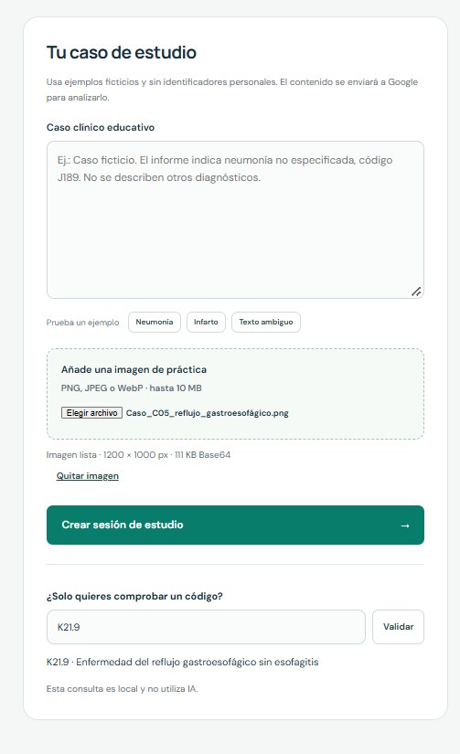
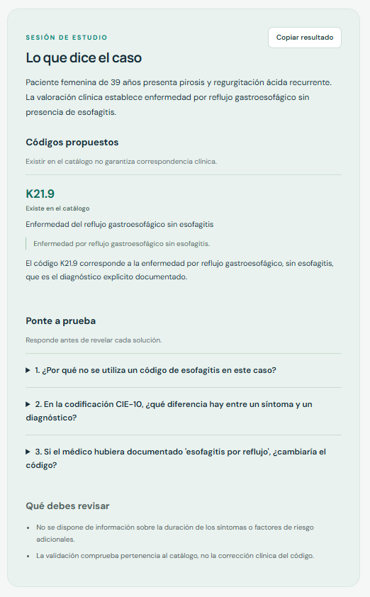

# CIE-10 Edu

**English** | [Español](README.es.md)

A lightweight medical coding study tool powered by **Gemma 4** and a local catalog of **11,008 ICD-10 codes with Spanish descriptions**. One screen, no package installation, and no database required.

## Example session

Upload a practice case, review the proposed code against the catalog, and use the questions to study. These screenshots show the Spanish-language interface and an example result for `K21.9`.

| Case input and local code lookup | Summary, catalog result, and study questions |
| --- | --- |
|  |  |

## Features

- Analyze fictional clinical cases entered as text or uploaded as PNG, JPEG, or WebP images.
- Get a case summary, proposed codes with supporting evidence and explanations, and three study questions with expandable answers.
- Validate proposed codes against a local catalog. The server normalizes formats such as `I219` → `I21.9`; displayed descriptions come from the catalog, not the model.
- Check individual codes locally without making an AI request.
- Try three built-in fictional examples and copy the structured results.
- Optimize images in the browser: up to 1280 px on the longest side, JPEG quality 80, and adaptive resizing until the Base64 payload, including its prefix, is below 350,000 bytes.

The current application interface, generated study material, and catalog descriptions are in **Spanish**. Cases are not stored on the server.

## How it works

```text
Fictional case: text or image
            |
            v
Validate input and prepare the image, if provided
            |
            v
Gemma 4 generates a summary, code proposals, and questions
            |
            v
Server normalizes codes and checks the local catalog
            |
       +----+----+
       |         |
     Found    Not found
       |         |
Catalog code  Proposal flagged
and label     for review
       |         |
       +----+----+
            |
            v
Review the result and answer three study questions
```

If the case contains no explicit diagnosis, the model is instructed not to propose codes. Invalid responses and API failures produce an error rather than a fabricated study session.

**A code existing in the catalog does not establish that it is clinically appropriate for the case.**

## Quick start

Requirements: **Python 3.11+** and a Google AI Studio API key with access to Gemma 4 through the Gemini API.

### Windows PowerShell

```powershell
Copy-Item .env.example .env
# Edit .env and set GEMINI_API_KEY. Git ignores this file.
python server.py
```

### macOS / Linux

```bash
cp .env.example .env
# Edit .env and set GEMINI_API_KEY. Git ignores this file.
python3 server.py
```

Open [http://127.0.0.1:8091](http://127.0.0.1:8091). No npm, Docker, PostgreSQL, or external Python packages are required. The API key stays on the server.

| Setting | Purpose | Default |
| --- | --- | --- |
| `GEMINI_API_KEY` | API credential; set it in your local `.env` | Required for AI analysis |
| `GEMMA_MODEL` | Hosted Gemma model | `gemma-4-26b-a4b-it` |
| `PORT` | Local server port | `8091` |

`gemma-4-31b-it` is also supported. Model access and quotas depend on your account. The app reports errors instead of silently switching to a Gemini model or simulated answers. See the [official Gemma API documentation](https://ai.google.dev/gemma/docs/core/gemma_on_gemini_api) for access details.

Use **synthetic cases only**: text and images are sent to Google for processing. This prototype listens on localhost and has no authentication or request rate limiting; it is intended for local demonstrations.

## Two-minute demo

1. Enter `i219` in the local code validator to see the canonical code and catalog description.
2. Select **Neumonía** and click **Crear sesión de estudio**. Review the summary, `J18.9`, and the questions.
3. Try answering each question before expanding its answer.
4. Select **Texto ambiguo** to explore an incomplete case. It should not produce an invented confirmed diagnosis.
5. Upload [`examples/caso_neumonia.png`](examples/caso_neumonia.png), a synthetic image containing fictional case text.

## Tests

```bash
python -m unittest discover -s tests -v
```

Use `python3` if that is your system's Python command. Tests do not call the API or use a database. They cover code normalization, catalog membership, response validation, accented JSON field labels, and invalid inputs. GitHub Actions runs the same suite.

### Local prototype verification — October 31, 2026

- **14 automated tests passed**, and JavaScript syntax checks passed.
- Browser checks covered local `i219` validation, a text case, a synthetic image analyzed by Gemma 4, and three expandable study answers.
- The ambiguous example returned no codes; this is not a general clinical accuracy evaluation.
- At a 390 px viewport, the tested page had no horizontal overflow. No JavaScript errors occurred during the browser checks.
- Empty analysis input was rejected with HTTP 422, and requests from a different browser origin with HTTP 403.

Real API checks used an authorized credential only in the process environment. No API key is included in this repository. These results are not a clinical certification or a load test, and no response-time guarantee is claimed.

## Scope and limitations

This is an **educational tool**, not a system for diagnosis, treatment, or clinical prioritization. Gemma may make mistakes or misread an image, and image compression may reduce legibility. Generated evidence, explanations, and questions require review.

This demo does not include PDF input, persistent history, user accounts, or LangGraph. The catalog is not claimed to cover all national ICD-10 modifications or the latest edition.

## License and catalog provenance

The project includes components adapted under the MIT license. Copyright notices and license terms are retained in [LICENSE](LICENSE) and [NOTICE.md](NOTICE.md). Catalog provenance is documented in [data/PROVENANCE.md](data/PROVENANCE.md).
